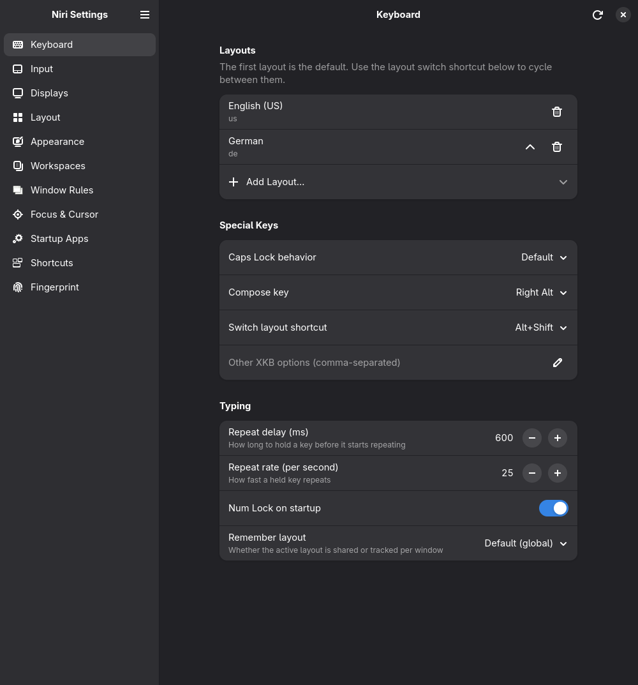
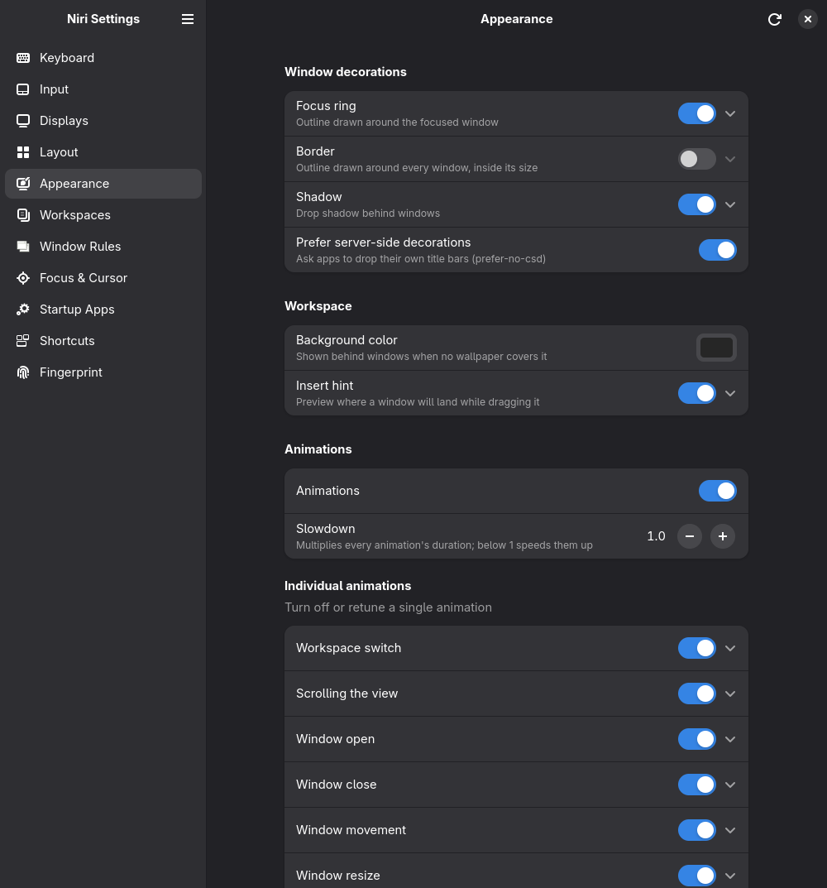
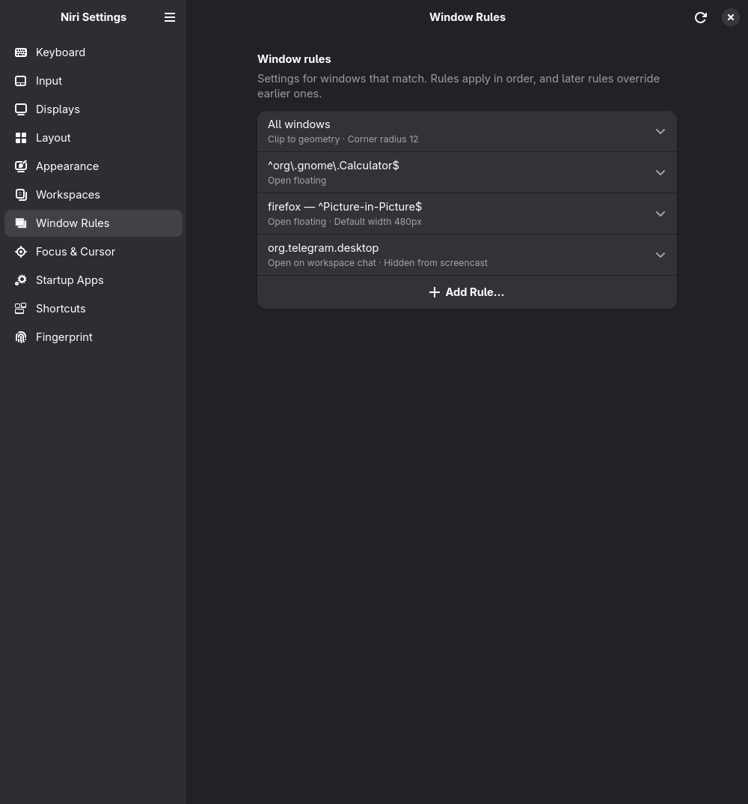
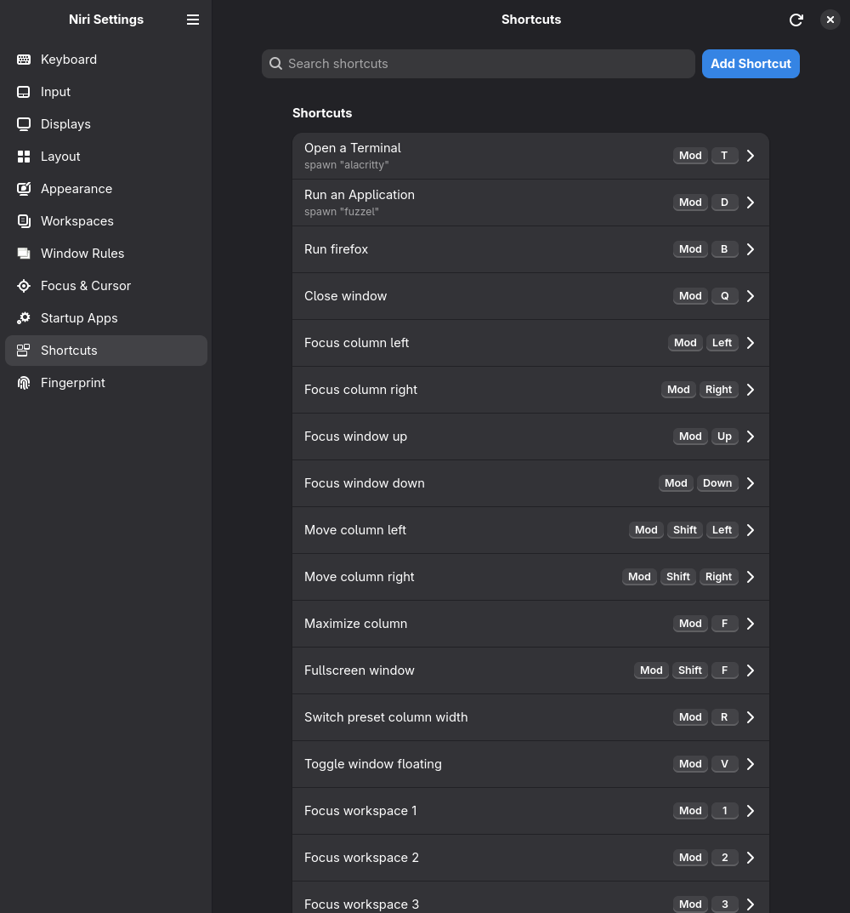

# Niri Settings


A GTK4 / libadwaita settings app for the [niri](https://github.com/YaLTeR/niri) Wayland compositor. It edits your existing `config.kdl` in place, so you can keep hand-editing the file alongside it.



Pages:

- **Keyboard**
- **Mouse**, **Touchpad**, **Trackpoint**, **Trackball**
- **Displays**: drag-to-arrange layout, one tab per display with resolution, refresh rate, scale, rotation, position, VRR, per-display colors
- **Layout**: new column width, preset widths/heights, centering, tabbed columns, gaps, struts
- **Appearance**: focus ring and border (colors or gradients), shadow, colors, insert hint, per-animation springs and easing, overview, hotkey overlay
- **Workspaces**: named workspaces, their order and which display they open on
- **Window Rules**: match apps by ID or title (or pick an open window) and set floating, size, workspace, opacity, corner radius and more
- **Focus & Cursor**: focus behaviour, mod key, hot corner, middle-click paste, Alt-Tab window switcher, cursor theme
- **Startup Apps**: programs and shell commands launched with niri
- **Shortcuts**: view and edit keybinds
- **Fingerprint**: enroll and remove fingerprints through `fprintd`

| Appearance | Window Rules | Shortcuts |
| --- | --- | --- |
|  |  |  |

Planned work, such as layer rules, tablet input and blur, is tracked in [the issues](https://github.com/lourw/niri-settings/issues).

## Requirements

- Rust 1.85+ (edition 2024)
- GTK **4.18+** and libadwaita **1.8+**, including their development headers
- `niri` on your `PATH` (used to validate and reload the config)
- Optional: `fprintd` for the Fingerprint page

On Arch / CachyOS:

```sh
sudo pacman -S rust gtk4 libadwaita
```

## Install (with app launcher icon)

```sh
./install.sh
```

This builds a release binary and installs it for your user:

| What         | Where                                                                  |
| ------------ | ---------------------------------------------------------------------- |
| Binary       | `~/.local/bin/niri-settings`                                           |
| Launcher     | `~/.local/share/applications/io.github.NiriSettings.desktop`           |
| Icon         | `~/.local/share/icons/hicolor/scalable/apps/io.github.NiriSettings.svg` |

"Niri Settings" then shows up in your app launcher (Noctalia, fuzzel, etc.). If it doesn't appear right away, restart the launcher or shell.

Set `PREFIX` to install somewhere else, e.g. `PREFIX=/usr/local sudo -E ./install.sh`.

To remove everything:

```sh
./install.sh uninstall
```

To update after pulling changes, run `./install.sh` again.

## Run without installing

```sh
cargo run --release
```

## How your config is handled

- **Location:** `$NIRI_CONFIG` if set, otherwise `$XDG_CONFIG_HOME/niri/config.kdl` (usually `~/.config/niri/config.kdl`). Files pulled in with `include` are followed, and edits go to whichever file holds the setting.
- **Never broken:** every change is checked with `niri validate` before it's written. If niri rejects it, the change is refused or rolled back and you get an error dialog.
- **No clobbering:** files are re-read from disk before every edit, so changes you make in a text editor while the app is open are kept. Use **Reload From Disk** (the refresh button) to update what the app shows.
- **Backups:** before a file is changed for the first time in a session, the original is copied to `~/.local/state/niri-settings/backups/<timestamp>/`. **Open Backups Folder** in the menu takes you there.
- **Live reload:** niri watches its config, including included files, and picks up changes immediately.

## Development

```sh
cargo build
cargo run
```

Debug builds log UI-thread timings to stderr (page builds, the reload after each edit, and background edits), marking anything over one frame (16 ms) as `SLOW`. Release builds compile this out.

To render every page to PNGs (handy for checking layout changes):

```sh
NIRI_SETTINGS_SCREENSHOT=/tmp/shots cargo run
```

The README screenshots are rendered from a demo config so they don't show anyone's personal setup:

```sh
NIRI_CONFIG=docs/screenshots/demo-config.kdl NIRI_SETTINGS_SCREENSHOT=/tmp/shots cargo run --release
```

The app ID is `io.github.NiriSettings` (`APP_ID` in `src/main.rs`). The `.desktop` file and icon in `data/` are named after it so niri can match the window to its launcher icon. If you change the ID, rename those files and update `install.sh` too.

| Path            | Purpose                                            |
| --------------- | -------------------------------------------------- |
| `src/main.rs`   | App window, sidebar, page list                     |
| `src/config.rs` | Loading the config, validating and saving edits    |
| `src/kdl.rs`    | KDL parser/editor that keeps your formatting       |
| `src/ui/`       | One module per settings page, plus shared widgets  |
| `data/`         | Desktop entry and icon                             |
| `install.sh`    | Build and install for the current user             |
